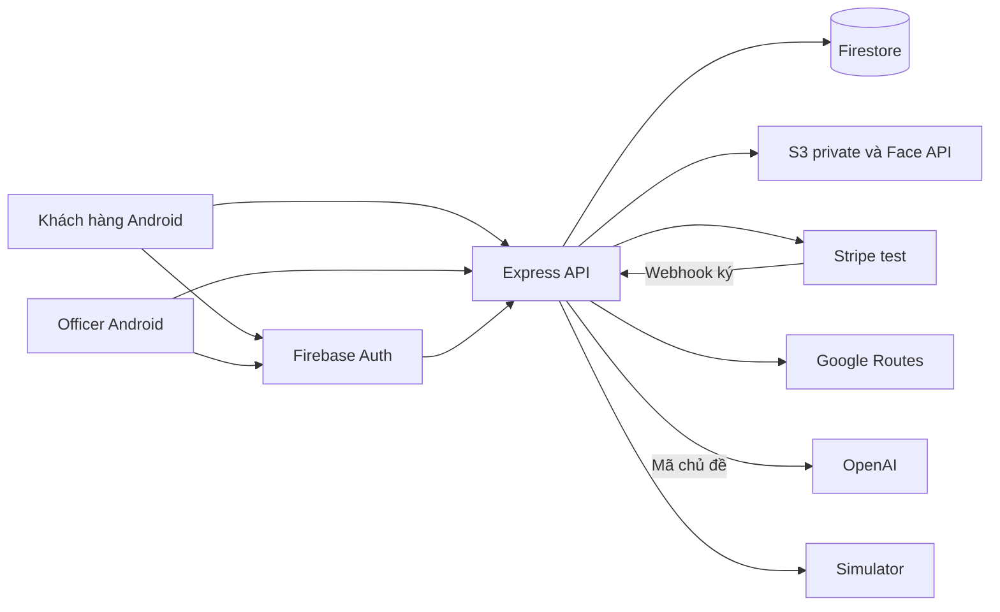
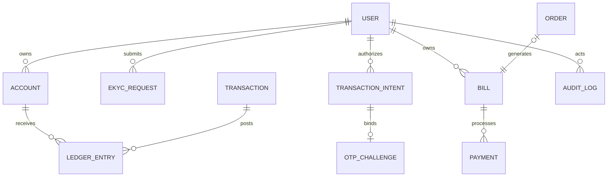
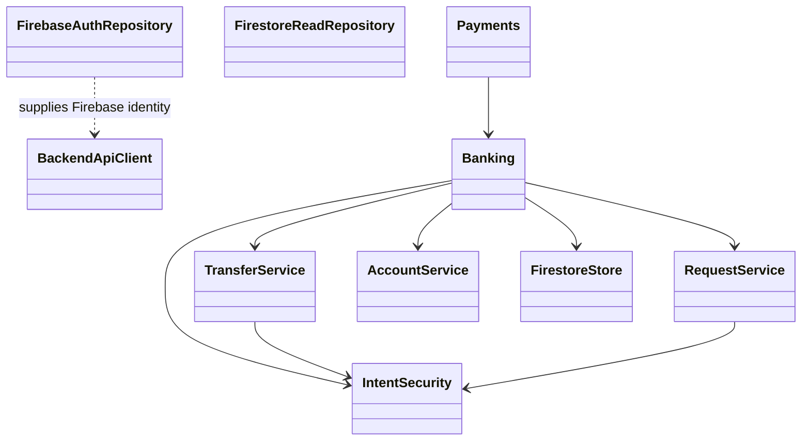

# Đối chiếu đề cuối kỳ Mobile Apps Development

Nguồn là `FinalProject_2026_2027.pdf`, 3 trang. Ba bản tìm thấy trong Downloads có cùng SHA-256. Bảng ghi trạng thái khảo sát ban đầu trước các sửa đổi của đợt này. “Đã có” chỉ mô tả bằng chứng trong mã nguồn.

| Đề bài | Trạng thái ban đầu | Bằng chứng và phần cần hoàn thiện |
|---|---|---|
| Business 1 · Hai vai trò, giao diện và quyền | Đã có | `MainActivity.java` điều hướng theo role, `backend/src/core/banking.ts` (`authorize`) kiểm quyền. |
| Business 1 · Officer tạo hồ sơ, sửa theo yêu cầu, khách xem/sửa hồ sơ | Đã có | `backend/src/modules/officer/officer.routes.ts` (POST/PATCH customers, changes), `backend/src/modules/profile/profile.routes.ts` (GET/PATCH me). Cần xác minh email kích hoạt và bỏ audit giả ở `OfficerFeatureFragment.renderAuditLogs`. |
| Business 2 · Đăng nhập, eKYC, ảnh sinh trắc, giá trị cao | Một phần / cần dịch vụ ngoài | `LoginFragment`, `EkycDialogFragment`, `backend/src/modules/ekyc/ekyc.service.ts` (submit), `modules/security/face.routes.ts` và `intent.ts`. Demo ảnh tĩnh, chưa có liveness, chống phát lại, OCR hay xác minh giấy tờ. |
| Business 2 · 2FA mọi giao dịch | Một phần | `backend/src/modules/security/intent.ts` (challenge/verify/consume) có OTP demo cho transfer và Stripe. OTP hiển thị trong cùng app nên chưa đáp ứng 2FA độc lập. Nạp/rút chỉ tạo yêu cầu. |
| Business 3 · Checking/savings/mortgage, số dư và giao diện | Một phần | `AccountListFragment`, `AccountDetailFragment`, `backend/src/modules/accounts/accounts.routes.ts`. Chi tiết savings/mortgage có số liệu mẫu. |
| Business 3 · Lãi suất/lợi nhuận tháng, Officer chỉnh policy | Một phần | `backend/src/modules/accounts/calculations.ts` (ACT/365), `modules/rates/rates.routes.ts`. Android chưa nối ước tính. |
| Business 3 · Kỳ trả mortgage theo tháng hoặc hai tuần | Một phần | `backend/src/modules/accounts/accounts.service.ts` (mortgage), `AccountDetailFragment.detailCopy` đang dùng nội dung tĩnh. |
| Business 3 · Lịch sử | Đã có | `TransactionHistoryFragment`, `backend/src/modules/transactions/transactions.routes.ts`. Cần kiểm chứng index/phân trang và offline. |
| Business 3 · Nạp/rút | Một phần | `MoneyRequestFragment`, `backend/src/modules/requests/requests.service.ts` chỉ ghi REQUESTED. |
| Business 4 · Kiểm tra trước khi ghi, chuyển nội bộ | Đã có trong chế độ demo | `backend/src/modules/transfers/transfers.service.ts` (commit nguyên tử, hạn mức ngày, ledger), `TransferFragment` (recovery). |
| Business 4 · Chuyển liên ngân hàng | Còn thiếu | `backend/src/modules/transfers/transfers.routes.ts` trả SETUP_REQUIRED. |
| Business 4 · VNPay hoặc Stripe | Một phần / cần dịch vụ ngoài | `UtilitiesHubDialogFragment` có PaymentSheet, `backend/src/modules/payments/payment.webhook.ts` và `payment.service.ts` xác nhận webhook test. Cần kiểm chứng sandbox được cấp phép. |
| Business 5 · Điện/nước | Một phần | `UtilitiesHubDialogFragment.handleLookup`, `backend/src/scripts/seed-demo.ts` có hóa đơn điện, chưa seed hóa đơn nước. |
| Business 5 · Nạp điện thoại | Một phần | `UtilitiesHubDialogFragment.proceedTopupOrder`, `backend/src/modules/orders/orders.routes.ts` và worker demo. |
| Business 5 · Vé máy bay/phim, phòng, mua hàng | Một phần | `backend/src/scripts/seed-demo.ts` có catalog và `modules/orders/orders.routes.ts` tạo hóa đơn demo. Android còn thiếu chọn sản phẩm và tra cứu fulfillment chung. |
| Business 6 · Vị trí, chi nhánh, tuyến đi bộ ngắn nhất | Một phần / cần dịch vụ ngoài | `BranchLocatorFragment` và `backend/src/modules/branches/branches.routes.ts`. Chọn theo đường chim bay rồi mới tìm route. |
| Business 7 · Chat và link tới chức năng | Còn thiếu | `domain/ChatbotService.java` là interface, `backend/src/modules/capabilities/capabilities.routes.ts` trả DEFERRED. |
| Technical 1 · Nhóm 2–3 người và ứng dụng Android | Một phần | `app/build.gradle.kts` và `app/src/main` có Android app. Thành viên nhóm cần xác nhận theo hồ sơ nộp. |
| Technical 2 · Database, ưu tiên cloud | Đã có | `firestore.rules`, `backend/src/infrastructure/firestore-store.ts`, `FirestoreReadRepository.java`. |
| Technical 3 · Google Play | Cần thao tác ngoài phạm vi | `app/build.gradle.kts` có app Android. Cần xác minh release ký và hoàn tất các bước Play sau phê duyệt. |
| Technical 4 · Báo cáo phân tích, thiết kế UML/ERD/use cases, triển khai và UI | Một phần | `README.md`, `docs/database-template-alignment.md`, `docs/superpowers/specs/`. Cần tổng hợp báo cáo nộp và ảnh chụp từ môi trường demo. |
| Technical 5 · Video demo | Còn thiếu bằng chứng | Chưa tìm thấy video trong repo. Checklist cuối tài liệu dùng để quay demo sau khi xác minh trên thiết bị. |

Thứ tự triển khai là quyền truy cập, audit, dữ liệu tài khoản và trạng thái lỗi trước. Tiếp theo là intent/OTP và settlement giả lập nguyên tử. Sau đó nối catalog, checkout và tra cứu. Cuối cùng hoàn thiện bản đồ và chatbot với cấu hình tách khỏi app, rồi kiểm tra lại trên dữ liệu local.

## Kết quả trong mã sau triển khai

| Hạng mục | Thay đổi và mức độ |
|---|---|
| Vai trò, hồ sơ và audit | Giữ luồng provision/onboarding, kiểm quyền ở backend và lưu lịch sử. Audit Android lấy API, hỗ trợ phân trang, lọc hai nhóm sự kiện và báo lỗi. Firestore chặn đọc audit trực tiếp, kiểm claims và quyền hồ sơ đối với tài khoản/giao dịch của khách hàng mà Officer cần đọc. |
| eKYC | Lỗi setup, bận hoặc timeout giữ REVIEWING để thử lại sau 60 giây. Lỗi ảnh cần hồ sơ mới. Đối chiếu ảnh tĩnh kể cả FULL_ID là demo. Mặt sau chỉ kiểm tra upload/version. Dịch vụ ảnh thật, liveness, OCR và chống phát lại vẫn thiếu bằng chứng. |
| Tiết kiệm và thế chấp | Android lấy dữ liệu từ backend và gắn nhãn demo theo tài khoản. Lãi 30 ngày dự tính theo ACT/365 lãi đơn, làm tròn half-up. Backend dùng policy đã đến hiệu lực theo sản phẩm với policy gắn tài khoản làm mốc dự phòng. Mortgage dùng lãi suất kỳ APR/12 hoặc APR/26, lịch dự phóng từ gốc hợp đồng; hiển thị dư nợ nếu dữ liệu có trường đó, ước tính kỳ đầu cho cả hai tần suất và tổng lịch theo hợp đồng. Lịch đánh số kỳ, chưa có ngày đến hạn lịch thực tế. |
| Nạp/rút | Yêu cầu thường vẫn dừng REQUESTED. Tại màn này, thao tác thực hành tạo yêu cầu và intent mô phỏng riêng cho checking demo. OTP và face theo ngưỡng trước khi pending. Đối soát cập nhật yêu cầu, số dư, giao dịch và bút toán đối ứng `DEMO_CLEARING` trong cùng transaction. |
| Chuyển tiền | Chuyển nội bộ kiểm tra quyền, trạng thái, số dư, loại tài khoản, ranh giới dữ liệu demo và hạn mức. Sau mất phản hồi tạo intent, Android tra cứu bằng request ID trước khi gửi lại cùng khóa. Chuyển liên ngân hàng mô phỏng có phí 0 theo quote, trạng thái pending, mã đối soát và kết quả kiểm thử định trước. |
| Tiện ích | Catalog demo cho điện/nước, nạp điện thoại, bay, phim, phòng và mua hàng. Điện/nước tra cứu hóa đơn của chủ sở hữu theo mã. Các lựa chọn mua hàng đóng gói theo SKU và một đơn vị trên Android. Backend kiểm tra giá lúc tạo đơn, quote 15 phút, thanh toán mô phỏng hoặc Stripe test, tra cứu payment và fulfillment độc lập. Giữ chỗ, ghế cụ thể, lịch khách sạn, giao hàng thật cần hệ thống đối tác riêng. |
| Stripe | Backend trước đó đã có webhook test và Android đã có PaymentSheet. App chọn Stripe test khi có cả cấu hình hai phía và chờ kết quả backend; phương án mô phỏng chỉ áp dụng cho hóa đơn gắn cờ demo. Giữ luồng worker để ghi `DEMO_FULFILLED` và mã đối soát. |
| Bản đồ | Chọn tên/địa chỉ trong danh sách độc lập với Google Maps và vị trí. Backend so khoảng cách route đi bộ trả về cho tối đa 20 chi nhánh hoạt động có tọa độ hợp lệ, hòa thì so thời gian. Vượt giới hạn yêu cầu chọn chi nhánh. Các lỗi provider không được chuyển thành kết quả “gần nhất”. |
| Chatbot | Chỉ khách hàng ACTIVE. Backend gửi mã chủ đề do server định nghĩa đến OpenAI Responses API. Văn bản tự do, UID, OTP, ảnh và thông tin tài khoản chỉ ở phía ứng dụng/backend. Mô hình chọn trong phạm vi mã chủ đề đã nhận. Backend sinh hướng dẫn cố định, Android kiểm allowlist và chỉ điều hướng sau khi người dùng bấm. Câu hỏi ngoài từ vựng được trả lời bằng hướng dẫn thử chủ đề có sẵn. |
| Tin cậy và phi chức năng | Firestore phát sự kiện thay đổi metadata để báo cache stale và gỡ listener khi màn ngừng quan sát. Lịch sử có lọc tháng và nhãn kết quả mô phỏng. Các màn checkout/chuyển tiền dùng mã cũ trong phiên và khi Android khôi phục trạng thái. App lưu ID intent theo người dùng trước khi commit chuyển tiền để tra cứu khi mở lại. Chưa chạy kiểm thử force-stop trên thiết bị cho mọi luồng, các tổ hợp index trên project cloud, accessibility trên thiết bị hoặc p95. |

### Dữ liệu và điều hướng

API Express xử lý phân quyền và điều phối nghiệp vụ. Store trì hoãn các ghi cho tới khi đọc xong trong transaction. Android Java/XML dùng ViewBinding và Navigation. Các adapter giữ kết nối Auth/Firestore, Stripe, Google Routes, S3 và Face API ở biên của hệ thống.

## Checklist duyệt và quay video

- [ ] Xác nhận danh sách 2–3 thành viên và phân công. Dùng sơ đồ trong mục trên và đối chiếu thêm field với `docs/database-template-alignment.md`.
- [ ] Dùng APK debug local và Auth/Firestore Emulator. Đăng nhập khách, kiểm tra savings/mortgage, lịch sử tháng, hồ sơ. Đăng nhập Officer, sửa dữ liệu thử và kiểm tra audit. Thử tài khoản Officer thiếu quyền.
- [ ] Chuyển nội bộ và quay OTP demo, xác nhận nguồn/đích/tổng phí. Thử mất mạng sau gửi rồi mở lại trạng thái. Thử hai yêu cầu cạnh tranh trên cùng nguồn với dữ liệu thử.
- [ ] Trong chuyển liên ngân hàng nhập `0000000001` cho kết quả mô phỏng thành công và `0000000002` cho từ chối, ngân hàng mẫu `DEMO_BANK`. Đợi ít nhất 5 giây rồi bấm kiểm tra lại, so số dư trước/sau và mã đối soát.
- [ ] Trong nạp/rút chọn “Thực hành xác thực và ghi sổ demo” trên checking demo. Kiểm tra tạo yêu cầu chưa đổi số dư và chỉ có bút toán sau đối soát.
- [ ] Dùng `local_demo_electricity`, `local_demo_water`, số nạp mẫu `0900000000` và SKU vé, phòng, hàng mẫu. Quay quote, OTP, kết quả thanh toán test, tra cứu đơn. Chạy worker riêng trong emulator để thấy fulfillment chuyển trạng thái.
- [ ] Thử chi nhánh khi thiếu bản đồ, từ chối vị trí và ngắt mạng. Xác minh polyline và so sánh route sau khi được phép dùng Google Routes với vị trí tổng hợp.
- [ ] Quay chat lúc chưa cấu hình, hướng dẫn điều hướng và từ chối thao tác ngoài phạm vi. Chỉ thử API provider sau khi được phép, với nội dung tổng hợp.
- [ ] Thử toàn luồng camera với ảnh thử đã được phép dùng, cấu hình S3 private và Face API. Thử ảnh sai chất lượng, trạng thái REVIEWING khi provider lỗi, thu hồi template, high-value step-up, và đăng nhập email dự phòng.
- [ ] Thực hiện TalkBack, cỡ chữ lớn, tương phản, cửa sổ offline và xoay màn hình. Đo thời gian tải/API trên thiết bị mục tiêu, ghi p95 bằng cùng dữ liệu và cấu hình.
- [ ] Trước khi gửi Play, xác nhận SDK/target và yêu cầu Play áp dụng lúc nộp, ký AAB bằng khóa riêng, kiểm tra các disclosure về dữ liệu/vị trí/sinh trắc và chính sách quyền riêng tư. Xin phê duyệt riêng trước khi phân phối hoặc phát hành.

## Bằng chứng kiểm tra local

| Lệnh | Kết quả |
|---|---|
| `npm --prefix backend run build` | Thoát 0. Biên dịch TypeScript cho backend. |
| `npm --prefix backend test` | 72 test đạt, 4 test Firebase Emulator bỏ qua theo thiết kế của lệnh này. HTTP, Routes, Stripe và OpenAI dùng dữ liệu/provider giả trong suite. |
| `CI=true FIREBASE_CLI_DISABLE_TELEMETRY=1 FIREBASE_SKIP_UPDATE_CHECK=true firebase --config firebase.backend-test.json emulators:exec --project demo-mobile-banking --only auth,firestore "npm --prefix backend run test:emulator"` | 4 test đạt. Bao gồm xác thực token Auth Emulator, kiểm quyền audit và ghi sổ khi chuyển khoản đồng thời với Firestore Emulator. |
| `./gradlew --offline testDebugUnitTest assembleDebug -PfirebaseDemo=true` | BUILD SUCCESSFUL. 32 unit test Android đạt. APK dành cho Android Emulator. |
| `./gradlew --offline testDebugUnitTest assembleDebug` | BUILD SUCCESSFUL. 32 unit test Android đạt với cấu hình build debug hiện có. Lệnh chỉ build và chạy unit test. |
| `~/Library/Android/sdk/build-tools/36.0.0/apksigner verify build/review/nimbus-local-demo-debug.apk` | Thoát 0, chữ ký debug hợp lệ. Kiểm tra tên resource trong APK demo không tìm thấy tài nguyên Google Services của cấu hình connected. |
| `git diff --check` | Thoát 0. |

APK xem xét nằm tại `build/review/nimbus-local-demo-debug.apk`. SHA-256 là `da555b7303a92e79a62b0b70ed76a7ce730196be3027e0b1f1da6f3a5b1585d8`. Đây là bản debug ký bằng khóa debug.

Lần chạy đầu trong sandbox chặn cổng loopback của test HTTP và chặn Gradle ghi cache. Các lượt cuối dùng quyền cho đúng hai thao tác đó và Gradle chạy offline. Một số test baseline tham chiếu cơ chế OTP/Firebase Phone và duyệt eKYC thủ công đã bị thay thế trong mã trước đợt sửa này. Test được cập nhật theo IntentSecurity và quy trình eKYC tự động hiện dùng, với các kiểm tra ràng buộc intent và quyền truy cập giữ trong suite.

Chưa chạy instrumentation Android, kiểm thử đầy đủ trên thiết bị, Stripe sandbox thực, S3/Face API thực, Google Routes thực hay OpenAI thực. Chưa đo hiệu năng hoặc đánh giá bảo mật production. Công việc phát hành, báo cáo nộp chính thức và video ở checklist duyệt.
